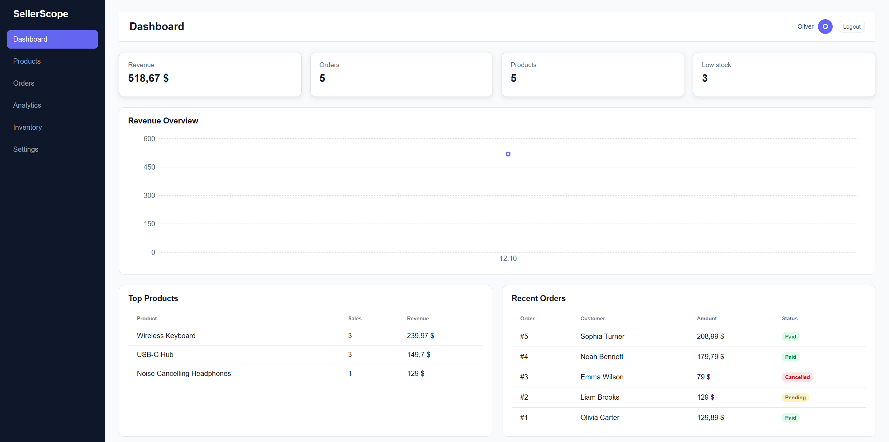
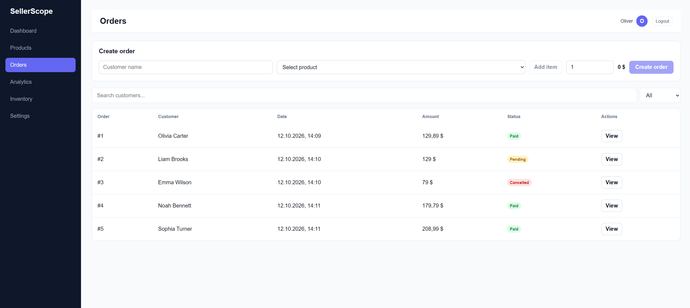
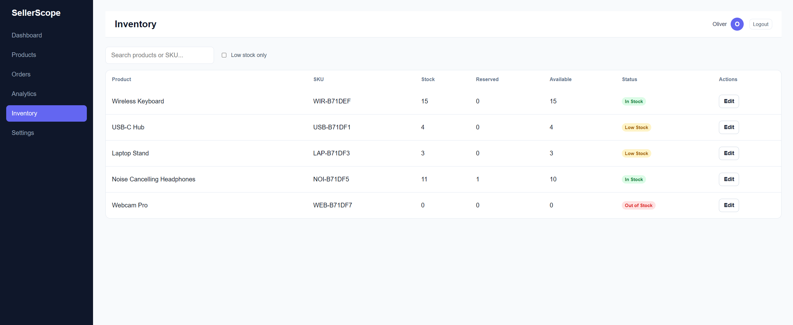

# SellerScope

SellerScope is a full-stack e-commerce admin dashboard for managing products, inventory, orders, analytics, and store settings.

The project was built as a portfolio application with a focus on practical business logic, authentication, responsive UI, protected API routes, and real-world inventory/order workflows.

## Live Demo

- Frontend: https://seller-scope-psi.vercel.app/
- API: https://sellerscope-api.onrender.com
- Health check: https://sellerscope-api.onrender.com/health

## Features

- User registration and login with JWT authentication
- Protected frontend routes and API endpoints
- Product creation, editing, deletion, filtering, and search
- Inventory management with stock, reserved, and available quantities
- Order creation with multiple products
- Order statuses: Pending, Paid, Cancelled
- Automatic stock reservation and release logic
- Revenue, order, and sales analytics
- Low-stock and out-of-stock tracking
- Store settings and currency selection
- Responsive layout for desktop, tablet, and mobile
- Automatic logout when an authenticated API request returns `401`

## Tech Stack

### Frontend

- React
- TypeScript
- Vite
- React Router
- TanStack Query
- Axios
- React Hook Form
- Zod
- Recharts
- CSS Modules

### Backend

- Node.js
- Express
- TypeScript
- MongoDB
- Mongoose
- JWT
- bcryptjs
- Zod

### Deployment

- Vercel — frontend
- Render — backend
- MongoDB Atlas — database
- UptimeRobot — API monitoring

## Screenshots

### Dashboard



### Orders



### Inventory



## Business Logic

SellerScope includes backend-driven business rules rather than relying only on frontend validation.

- New orders are created with `Pending` status
- Pending orders reserve inventory without immediately reducing physical stock
- Changing an order from `Pending` to `Paid` decreases both stock and reserved quantity
- Changing an order from `Pending` to `Cancelled` releases the reserved quantity
- Product availability is calculated from `stock - reserved`
- Product status is derived from the available quantity
- Inventory stock cannot be reduced below the reserved quantity
- Product deletion is blocked when inventory is still reserved
- Order amounts are calculated from canonical product prices on the backend

## Getting Started

### Prerequisites

Make sure you have installed:

- Node.js
- npm
- MongoDB Atlas account or a local MongoDB instance

### Installation

Clone the repository:

```bash
git clone https://github.com/Whereismynick/SellerScope.git
cd SellerScope
```

Install dependencies:

```bash
npm install
```

Create a `.env` file in the project root:

```env
MONGODB_URI=your_mongodb_connection_string
JWT_SECRET=your_jwt_secret
PORT=3001
FRONTEND_URL=http://localhost:5173
```

Create a `.env.local` file in the project root:

```env
VITE_API_URL=http://localhost:3001/api
```

Start the backend:

```bash
npm run server
```

Start the frontend in another terminal:

```bash
npm run dev
```

Open:

```text
http://localhost:5173
```

## API Overview

### Public routes

| Method | Endpoint | Description |
| --- | --- | --- |
| `POST` | `/api/auth/register` | Create a new account |
| `POST` | `/api/auth/login` | Sign in and receive a JWT |
| `GET` | `/health` | API health check |

### Protected routes

| Method | Endpoint | Description |
| --- | --- | --- |
| `GET` | `/api/products` | Get products |
| `GET` | `/api/products/:id` | Get a product by ID |
| `POST` | `/api/products` | Create a product |
| `PATCH` | `/api/products/:id` | Update a product |
| `DELETE` | `/api/products/:id` | Delete a product |
| `GET` | `/api/orders` | Get orders |
| `POST` | `/api/orders` | Create an order |
| `PATCH` | `/api/orders/:id` | Update order status |
| `GET` | `/api/inventory` | Get inventory |
| `PATCH` | `/api/inventory/:id` | Update inventory stock |
| `GET` | `/api/settings` | Get user/store settings |
| `PATCH` | `/api/settings` | Update user/store settings |

## Project Structure

```text
SellerScope/
├── docs/
│   └── screenshots/
├── server/
│   ├── config/
│   ├── middleware/
│   ├── models/
│   ├── routes/
│   ├── types/
│   ├── utils/
│   ├── validation/
│   └── index.ts
├── src/
│   ├── api/
│   ├── components/
│   ├── context/
│   ├── hooks/
│   ├── layouts/
│   ├── pages/
│   ├── types/
│   └── utils/
├── index.html
├── package.json
└── README.md
```

## Scripts

```bash
npm run dev
npm run server
npm run build
npm run lint
npm run preview
npm run start
```

## Notes

- The frontend and backend are kept in a single repository.
- Authentication is handled with JWT.
- Protected API routes are scoped to the authenticated user.
- The deployed frontend communicates with the Render API through `VITE_API_URL`.
- Currency formatting supports RUB, USD, and EUR.

## Author

Developed by [Whereismynick](https://github.com/Whereismynick).
